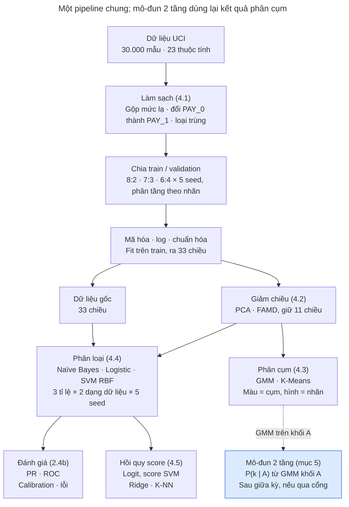
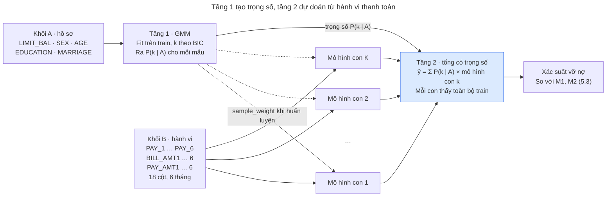

# Dự đoán vỡ nợ thẻ tín dụng (Taiwan Credit Default)

> **Ghi chú về bản chép này**
>
> - Chép từ Google Doc kế hoạch của nhóm (id `18sPLzbAvAZuLnBk2RGK9JiVLfOQjmAUQQDwaAxTe2J4`) ngày 2026-11-15. Google Doc vẫn là **nguồn chính** (source of truth) khi còn đang chỉnh sửa; bản này có thể lỗi thời.
> - Chỗ lệch đã biết giữa kế hoạch và repo (phần thân bên dưới giữ nguyên văn bản gốc):
>   - (a) Repo dùng `README.md` thay vì `README.txt` (mục 7.2, 7.4).
>   - (b) Mục 4.5 và 6.3 nói "test", nhưng dự án chỉ có train/validation; code (`src/score_reg.py`) dùng validation.
>   - (c) Repo có thêm file ngoài cây thư mục ở mục 7.4: `src/config.py`, `src/data.py`, `src/eda.py`, `src/metrics.py`, `scripts/create_issues.sh`, `requirements.txt`.
>   - (d) Sơ đồ mục 3 gốc ghi 29 chiều / 10 chiều (trước khi thêm 4 đặc trưng dẫn xuất); bản vẽ lại dùng 33 / 11 theo mục 4.1.
>   - (e) Mục 7.1 đã cập nhật trong repo (phân công theo issue, mô-đun 2 tầng tách riêng do synaamin làm, tùy chọn); Google Doc chưa sửa.
> - Hai sơ đồ (mục 3 và mục 5) bị mất khi xuất Google Doc; đã vẽ lại bằng mermaid từ hình gốc.

## 1. Tóm tắt đề tài

Nhóm làm bài toán **phân loại nhị phân** (nhóm 2 của đề): dự đoán khách hàng thẻ tín dụng có vỡ nợ tháng kế tiếp hay không, trên bộ UCI *Default of Credit Card Clients* (30.000 mẫu, 23 thuộc tính). Toàn bộ phần bắt buộc 2.1–2.4 là khung chính; mô-đun 2 tầng chỉ là mục mở rộng sau giữa kỳ.

| **Hạng mục** | **Nội dung** |
| :-: | :-: |
| **Tên đề tài** | Dự đoán vỡ nợ thẻ tín dụng bằng các phương pháp học máy: so sánh mô hình sinh – phân biệt và ảnh hưởng của giảm chiều, phân khúc khách hàng |
| **Tên tiếng Anh** | *Credit Card Default Prediction: Generative vs. Discriminative Models, Dimensionality Reduction and Segment-Aware Extension* |
| **Dữ liệu** | UCI Default of Credit Card Clients, khách hàng tại Đài Loan, 04/2005 – 09/2005 |
| **Đầu vào** | 23 thuộc tính: hạn mức, nhân khẩu học, 6 tháng trạng thái thanh toán, 6 tháng sao kê, 6 tháng số tiền đã trả |
| **Đầu ra** | default.payment.next.month (0 = không vỡ nợ, 1 = vỡ nợ) |
| **Mô hình chính** | Gaussian Naïve Bayes (nhóm 1), Logistic Regression (nhóm 2), SVM RBF (nhóm 3) |
| **Giảm chiều** | PCA và FAMD |
| **Phân cụm** | GMM (EM) và K-Means |

**Câu hỏi nghiên cứu**

1. **RQ1.** Ba họ mô hình (sinh / phân biệt tuyến tính / phân biệt phi tuyến) khác nhau thế nào trên dữ liệu gốc và dữ liệu giảm còn 1/3 số chiều, qua 3 tỉ lệ chia 8:2, 7:3, 6:4?
2. **RQ2.** Score quyết định của Logistic và SVM cho lớp "vỡ nợ" có thể xấp xỉ được bằng mô hình hồi quy đến mức nào (mục 2.4(c))?
3. **RQ3 (mở rộng).** Phân khúc khách hàng theo hồ sơ có cải thiện dự đoán không, và lợi ích đó có phụ thuộc năng lực của mô hình gốc không?

**Ngoài phạm vi:** không xây hệ thống chấm điểm tín dụng thực tế, không khuyến nghị quyết định cho vay.

## 2. Phân tích dữ liệu Taiwan Credit

Bộ dữ liệu đạt mọi điều kiện của đề (≥15 thuộc tính, ≥300 mẫu, có cả số và category) và có cấu trúc khối rõ ràng, thuận cho cả phần bắt buộc lẫn mô-đun 2 tầng. Theo [trang UCI](https://archive.ics.uci.edu/dataset/350/default+of+credit+card+clients), bộ có 30.000 mẫu và 23 thuộc tính; khoảng 22,1% khách hàng vỡ nợ. Mô tả cột dưới đây theo tài liệu gốc của UCI; nhóm cần đối chiếu lại khi tải file.

### 2.1. Cấu trúc theo khối

| **Khối** | **Cột** | **Kiểu** | **Ý nghĩa** |
| :-: | :-: | :-: | :-: |
| A – Hồ sơ | LIMIT_BAL | Số liên tục | Hạn mức tín dụng (NT$), gồm cả thẻ phụ của gia đình |
| A – Hồ sơ | SEX | Category (2 mức) | 1 = nam, 2 = nữ |
| A – Hồ sơ | EDUCATION | Category (4 mức) | 1 = sau đại học, 2 = đại học, 3 = trung học, 4 = khác |
| A – Hồ sơ | MARRIAGE | Category (3 mức) | 1 = đã kết hôn, 2 = độc thân, 3 = khác |
| A – Hồ sơ | AGE | Số nguyên | Tuổi (năm) |
| B – Trạng thái trả | PAY_0, PAY_2 … PAY_6 | Thứ bậc | Trạng thái trả nợ từ 09/2005 lùi về 04/2005: −1 = trả đúng hạn, 1…9 = trễ 1…≥9 tháng |
| B – Sao kê | BILL_AMT1 … BILL_AMT6 | Số liên tục | Số dư sao kê từng tháng (NT$), tháng 1 = 09/2005 |
| B – Số tiền trả | PAY_AMT1 … PAY_AMT6 | Số liên tục | Số tiền đã trả từng tháng (NT$) |
| Nhãn | default.payment.next.month | Nhị phân | Vỡ nợ tháng 10/2005 |

Khối A có 5 cột, khối B có 18 cột trải 6 tháng. Đây là điểm khác biệt chính so với Telco: khối B là **hành vi theo thời gian**, không phải ảnh chụp tĩnh.

### 2.2. Lỗi dữ liệu đã biết

| **Vấn đề** | **Cột** | **Xử lý đề xuất** |
| :-: | :-: | :-: |
| Giá trị ngoài tài liệu (0, 5, 6) | EDUCATION | Gộp vào mức 4 = "khác", báo cáo số mẫu bị gộp |
| Giá trị ngoài tài liệu (0) | MARRIAGE | Gộp vào mức 3 = "khác" |
| Giá trị −2 và 0 không được giải thích đầy đủ | PAY_x | Giữ làm biến thứ bậc; diễn giải −2 = không phát sinh dư nợ, 0 = trả tối thiểu (giả định của nhóm, ghi rõ trong báo cáo) |
| Tên cột nhảy số | PAY_0 (không có PAY_1) | Đổi tên thành PAY_1 cho đồng nhất với BILL_AMT1 |
| Sao kê âm | BILL_AMT\* | Giữ nguyên (khách trả dư); kiểm tra tỉ lệ |
| Phân phối lệch phải nặng | LIMIT_BAL, BILL_AMT\*, PAY_AMT\* | Biến đổi log có dấu: sign(x) · log(1 + \|x\|), rồi chuẩn hóa |
| Mẫu trùng lặp | Toàn bộ | Kiểm tra và loại bản ghi trùng hoàn toàn |
| File gốc là .xls, dòng tiêu đề kép | — | Đọc bằng ucimlrepo (id = 350) hoặc pd.read_excel(header=1) |

### 2.3. Mất cân bằng lớp

Tỉ lệ khoảng 78 : 22. Mô hình đoán toàn bộ là "không vỡ nợ" đã đạt khoảng 78% accuracy, nên accuracy không được dùng làm metric chính. Dùng F1 lớp vỡ nợ, PR-AUC, ROC-AUC và balanced accuracy; chia dữ liệu có phân tầng theo nhãn.

### 2.4. Rủi ro rò rỉ dữ liệu

Không có cột nào chứa thông tin sau thời điểm dự đoán: mọi cột thuộc 04–09/2005, nhãn là 10/2005. Mỗi khách hàng là một dòng, nên chia ngẫu nhiên có phân tầng là hợp lệ. Rò rỉ chỉ có thể đến từ quy trình: scaler, PCA, FAMD, GMM đều phải fit trên train.

### 2.5. Trích xuất đặc trưng (bắt buộc, làm trước giữa kỳ)

| Đặc trưng | Công thức | Ý nghĩa |
| :-: | :-: | :-: |
| Tỉ lệ sử dụng hạn mức | BILL_AMT1 / LIMIT_BAL | Mức căng thẳng tín dụng hiện tại |
| Tỉ lệ trả | PAY_AMT1 / BILL_AMT2 (cắt về \[0, 1\]) | Trả bao nhiêu phần sao kê tháng trước |
| Số tháng trễ hạn | Đếm PAY_x ≥ 1 | Tần suất trễ |
| Xu hướng trễ | Hệ số góc của PAY_x theo tháng | Đang xấu đi hay tốt lên |

Xử lý trường hợp đặc biệt: khi BILL_AMT2 ≤ 0 (không có dư nợ), tỉ lệ trả gán bằng 1. Mỗi đặc trưng chỉ tính từ chính dòng dữ liệu đó nên không gây rò rỉ. Bước này thuộc tiền xử lý nên phải xong trước giữa kỳ.

Cấu hình chính dùng dữ liệu có đặc trưng dẫn xuất. Chạy thêm cấu hình không có đặc trưng dẫn xuất ở tỉ lệ 7:3 để tách hiệu ứng của feature engineering khỏi hiệu ứng của mô hình.

## 3. Kiến trúc tổng thể

Một pipeline duy nhất phục vụ mọi phần của đề; mô-đun 2 tầng không cần dữ liệu hay phân cụm riêng mà dùng lại kết quả GMM.



*pipeline tổng thể · phần bắt buộc + mô-đun mở rộng* — *Một pipeline chung; mô-đun 2 tầng dùng lại kết quả phân cụm* (vẽ lại từ hình gốc trong Google Doc). Mọi bước có fit chỉ học trên train; validation chỉ transform hoặc predict.

Đọc từ trên xuống: dữ liệu đi qua làm sạch, chia, mã hóa, rồi tách thành 2 nhánh gốc và giảm chiều. Cả 2 nhánh vào phần phân loại; nhánh giảm chiều vào thêm phân cụm. Ô tô màu là phần mở rộng, chỉ làm sau giữa kỳ.

## 4. Spec từng phần theo đề

Mỗi mục dưới đây ánh xạ trực tiếp vào yêu cầu 2.1–2.4 của đề, kèm đầu ra cụ thể cần có trong báo cáo.

### 4.1. Tiền xử lý (2.1)

1. Đọc dữ liệu, đổi tên PAY_0 → PAY_1, bỏ cột ID.
2. Thống kê sơ bộ: kiểu dữ liệu, số giá trị khác nhau, missing, min/max, phân phối nhãn.
3. Làm sạch theo bảng 2.2: gộp mức lạ của EDUCATION, MARRIAGE, loại bản ghi trùng.
4. Trích xuất đặc trưng theo mục 2.5: thêm 4 đặc trưng dẫn xuất (tỉ lệ sử dụng hạn mức, tỉ lệ trả, số tháng trễ hạn, xu hướng trễ).
5. Chia train/validation **có phân tầng theo nhãn** cho từng tỉ lệ 8:2, 7:3, 6:4. Mọi bước sau đây chỉ fit trên train.
6. Mã hóa: SEX, EDUCATION, MARRIAGE → one-hot; PAY_x giữ dạng số thứ bậc.
7. Biến đổi: log có dấu cho các cột tiền, rồi StandardScaler.
8. Tăng cường dữ liệu (xử lý mất cân bằng lớp), chỉ trên tập train; tập validation giữ nguyên phân phối thật. So sánh 3 phương án: B0 không xử lý; B1 class_weight='balanced' (Logistic, SVM); B2 SMOTENC sinh mẫu tổng hợp cho lớp vỡ nợ, xử lý đúng các cột category, cân bằng về 1:1. Dùng imblearn.pipeline.Pipeline để SMOTENC chỉ chạy bên trong từng fold khi dò siêu tham số bằng CV. So sánh B0/B1/B2 ở tỉ lệ 7:3 × 5 seed × 3 mô hình; phương án tốt nhất theo PR-AUC được dùng cho mọi thí nghiệm còn lại. Báo cáo số mẫu trước và sau tăng cường.
9. Mô tả lại dữ liệu sau chuẩn hóa: bảng thống kê, histogram trước và sau.

**Số chiều sau mã hóa:** 20 cột số (LIMIT_BAL, AGE, 6 PAY, 6 BILL_AMT, 6 PAY_AMT) + 4 đặc trưng dẫn xuất + 2 + 4 + 3 cột one-hot = **33 chiều**. Giảm về 1/3 tức **khoảng 11 chiều**. Tính lại nếu đổi cách mã hóa hoặc thêm, bớt đặc trưng.

**Đầu ra:** notebook 01_preprocess, bảng thống kê trước/sau, pipeline sklearn tái sử dụng được cho mọi thí nghiệm.

Phân tích thống kê và trực quan hóa dữ liệu gốc (phần thống kê của mục 2.2 trong đề), làm trước khi giảm chiều:

Thống kê theo từng trường: mean, median, std, min, max, skewness, kurtosis cho các cột số; bảng tần suất và tỉ lệ vỡ nợ theo từng mức cho các cột category.

Thống kê tổng thể: heatmap ma trận tương quan Pearson giữa các cột số, chú ý khối 6 cột BILL_AMT thường tương quan rất mạnh với nhau.

Biểu đồ chọn lọc, mỗi biểu đồ trả lời một câu hỏi: (1) tỉ lệ vỡ nợ theo từng giá trị PAY_1: lịch sử trễ hạn gần nhất có quyết định khả năng vỡ nợ không; (2) tỉ lệ vỡ nợ theo khoảng LIMIT_BAL: hạn mức thấp có rủi ro cao hơn không; (3) tỉ lệ vỡ nợ theo nhóm tuổi, học vấn, hôn nhân: hồ sơ nhân khẩu học ảnh hưởng thế nào; (4) đường trung bình BILL_AMT và PAY_AMT qua 6 tháng, tách theo nhãn: hành vi nhóm vỡ nợ khác nhóm còn lại ra sao theo thời gian; (5) biểu đồ cột phân phối nhãn: mức độ mất cân bằng.

Đầu ra phần thống kê: bảng thống kê, heatmap tương quan, 5 biểu đồ trên, mỗi biểu đồ kèm 1–2 câu nhận xét.

### 4.2. Giảm chiều và trực quan hóa (2.2)

| Phương pháp | Áp dụng cho | Vì sao chọn | Đo thông tin bảo tồn |
| :-: | :-: | :-: | :-: |
| PCA | 33 chiều đã chuẩn hóa | Phương pháp chuẩn, có explained variance ratio | explained_variance_ratio_ |
| FAMD | Dữ liệu gốc dạng hỗn hợp (số + category) | Thiết kế riêng cho dữ liệu lẫn số và category, khác bản chất với PCA trên one-hot | Tỉ lệ quán tính (inertia) giải thích, thư viện prince |
| t-SNE (chỉ để nhìn) | 2 chiều | Bổ sung trực quan cụm, không dùng cho mô hình | Không có, ghi rõ trong báo cáo |

**Không dùng TruncatedSVD làm phương pháp thứ hai:** trên dữ liệu đã định tâm, kết quả gần trùng PCA. **Không dùng LDA:** bài nhị phân chỉ cho 1 thành phần, không vẽ được 4–6 cặp thành phần.

Việc cần làm cho mỗi phương pháp:

- Scree plot và đường tích lũy explained variance; số thành phần để đạt 80%, 90%.
- Ma trận scatter từng cặp cho 5 thành phần đầu, tô màu theo nhãn.
- Loadings của 2–3 thành phần đầu: thành phần nào gắn với khối trạng thái trả, khối sao kê, khối hồ sơ.
- Scatter thành phần chính so với nhãn (boxplot hoặc tỉ lệ vỡ nợ theo khoảng) để xem khả năng tách lớp.
- Bảng so sánh PCA và FAMD: explained variance tại 11 thành phần, khả năng tách lớp, khả năng giải thích.

### 4.3. Phân cụm (2.3)

| Thuật toán | Chọn số cụm | Dữ liệu đầu vào |
| :-: | :-: | :-: |
| GMM (EM) | BIC và AIC với k = 2…10 | 11 thành phần PCA hoặc FAMD |
| K-Means | Elbow và silhouette với k = 2…10 | Cùng dữ liệu với GMM để so sánh công bằng |

Độ đo định lượng:

- **Chất lượng cụm (không dùng nhãn):** silhouette, Davies–Bouldin, Calinski–Harabasz.
- **Quan hệ cụm và nhãn:** tỉ lệ vỡ nợ từng cụm, kiểm định chi-bình phương (cụm × nhãn), ARI và NMI giữa cụm và nhãn.
- **Hồ sơ cụm:** trung bình từng thuộc tính theo cụm, mô tả mỗi cụm bằng 1 câu.
- **Trực quan:** scatter PC1–PC2, **màu = cụm, hình dạng điểm = nhãn**, đúng yêu cầu của đề.

Kết quả GMM của mục này được dùng lại làm tầng 1 trong mô-đun mở rộng (mục 5), nên lưu cả mô hình và predict_proba.

### 4.4. Phân loại (2.4(a), (b))

| Mô hình | Nhóm trong đề | Loại | Siêu tham số dò | Hiệu chỉnh chống overfit |
| :-: | :-: | :-: | :-: | :-: |
| Gaussian Naïve Bayes | Nhóm 1 | Sinh, tuyến tính trong log-odds | var_smoothing | var_smoothing lớn hơn |
| Logistic Regression | Nhóm 2 | Phân biệt, tuyến tính | C, penalty ∈ {L1, L2} | L2 / L1 qua C |
| SVM RBF | Nhóm 3 | Phân biệt, phi tuyến | C, gamma | Giảm C, giảm gamma |

Ma trận thí nghiệm: 3 mô hình × 3 tỉ lệ chia × 2 dạng dữ liệu (33 chiều / 11 chiều) = **18 cấu hình**, mỗi cấu hình 5 seed.

- **Dò siêu tham số:** 5-fold CV có phân tầng trên tập train, tối ưu theo PR-AUC.
- **Chi phí SVM:** RBF SVM trên khoảng 24.000 mẫu train rất chậm khi dò lưới. Dò lưới trên mẫu con phân tầng 10.000; huấn luyện mô hình cuối trên toàn bộ train nếu kịp thời gian, và ghi rõ trong báo cáo.
- **Overfit:** báo cáo metric trên cả train và validation; vẽ learning curve theo kích thước train và validation curve theo C.
- **Mất cân bằng lớp:** thử class_weight='balanced' cho Logistic và SVM; chọn ngưỡng quyết định trên tập validation theo F1.
- Dữ liệu giảm chiều dùng cho phân loại và 2.4(c): PCA 11 thành phần, vì PCA fit/transform trực tiếp trong Pipeline sklearn. FAMD dùng cho phần so sánh ở mục 4.2 và chạy thêm một lượt phân loại đối chứng ở tỉ lệ 7:3.
- Naïve Bayes và regularization: GaussianNB không có tham số phạt như Logistic hay SVM; var_smoothing chỉ cộng thêm một lượng nhỏ vào phương sai để tránh chia cho số quá nhỏ, nên tác dụng chống overfit rất hạn chế. Báo cáo cần nêu rõ điều này. Với 30.000 mẫu và ít tham số, NB ít có nguy cơ overfit; vấn đề thường gặp của NB là underfit do giả định độc lập.

**2.4(b) – dự đoán so với thực tế:**

- Confusion matrix cho mỗi mô hình ở tỉ lệ 7:3.
- Đường ROC và Precision–Recall chồng 3 mô hình trên 1 hình.
- **Đường calibration (reliability diagram):** xác suất dự đoán so với tỉ lệ vỡ nợ thực tế theo từng khoảng. Đây là cách trả lời trực tiếp nhất cho câu "tương quan dự đoán – thực tế".
- Phân tích lỗi: đặc điểm của nhóm false negative (vỡ nợ mà mô hình bỏ sót).
- Kết luận mức phù hợp (bắt buộc cho từng mô hình): dựa trên các biểu đồ trên, mỗi mô hình có một đoạn kết luận phù hợp / phù hợp có điều kiện / không phù hợp, kèm giải thích bằng giả định của mô hình.
- Naïve Bayes giả định các thuộc tính độc lập khi biết nhãn và có phân phối Gauss. 6 cột BILL_AMT tương quan mạnh nên vi phạm giả định độc lập; dự kiến xác suất bị đẩy về 0 hoặc 1, đường calibration lệch xa đường chéo.
- Logistic giả định log-odds tuyến tính theo đặc trưng. Calibration tốt nếu quan hệ gần tuyến tính; kiểm tra xem các nhóm lỗi có tập trung ở vùng phi tuyến không.
- SVM RBF không giả định phân phối, nhưng score không phải xác suất: cần Platt scaling mới so được calibration; đánh giá thêm chi phí thời gian huấn luyện.

### 4.5. Chuyển sang hồi quy trên score (2.4(c))

1. Chọn lớp "vỡ nợ" (y = 1).
2. Huấn luyện Logistic và SVM **chỉ trên train**; lấy decision_function cho cả train và test làm đầu ra mới (logit với Logistic, khoảng cách có dấu tới siêu phẳng với SVM).
3. Hồi quy đầu ra mới bằng **Ridge** và **K-NN Regressor**, trên dữ liệu 33 chiều và 11 chiều.
4. Ma trận thí nghiệm: 2 score gốc (Logistic, SVM) × 2 mô hình hồi quy (Ridge, K-NN) × 2 dạng dữ liệu (33 / 11 chiều) × 3 tỉ lệ chia 8:2, 7:3, 6:4 (đúng như 2.4(a)) = 24 cấu hình, mỗi cấu hình 5 seed. Dùng lại đúng phân hoạch dữ liệu của mục 4.4.
5. Metric: R², RMSE, MAE trên test.

**Kết quả dự kiến và lời giải thích (điểm đáng viết nhất của mục này):**

| Score gốc | Ridge, 33 chiều | Ridge, 11 chiều | K-NN |
| :-: | :-: | :-: | :-: |
| Logit của Logistic | R² gần 1: logit là hàm tuyến tính của chính các đặc trưng đó | Giảm theo lượng thông tin mất khi giảm chiều | Thấp hơn Ridge: xấp xỉ cục bộ một hàm vốn tuyến tính toàn cục |
| Score SVM RBF | Thấp hơn hẳn: score là hàm phi tuyến | Giảm tiếp | Có thể vượt Ridge vì bắt được tính phi tuyến |

Đây là dự đoán dựa trên bản chất mô hình, không phải kết quả đã chạy. Nếu kết quả thực tế lệch, phần giải thích sự lệch đó chính là nội dung phân tích.

## 5. Mô-đun mở rộng: mô hình 2 tầng rút gọn

Mô-đun này chỉ làm **sau giữa kỳ** và chỉ khi qua được cổng kiểm tra tương tác. Mục tiêu không phải chứng minh 2 tầng tốt hơn, mà trả lời RQ3: lợi ích của phân khúc có tỉ lệ nghịch với năng lực mô hình gốc không.



*mô-đun 2 tầng · soft routing theo hậu nghiệm GMM* — *Tầng 1 tạo trọng số, tầng 2 dự đoán từ hành vi thanh toán* (vẽ lại từ hình gốc trong Google Doc). Không mô hình con nào chỉ học trên một cụm nhỏ: trọng số thay cho việc cắt dữ liệu.

Khối A chỉ quyết định trọng số; dự đoán đến từ khối B. Nét đứt là bước huấn luyện: cùng trọng số P(k | A) dùng làm sample_weight cho từng mô hình con.

### 5.1. Phân khối đặc trưng

- **Tầng 1 – phân khúc:** khối A (LIMIT_BAL, SEX, EDUCATION, MARRIAGE, AGE). Dùng lại GMM của mục 4.3 nhưng fit riêng trên khối A, chọn k bằng BIC; đầu ra là xác suất hậu nghiệm P(k | A).
- **Tầng 2 – dự đoán:** khối B (18 cột hành vi thanh toán).

### 5.2. Cổng kiểm tra (làm trước mọi thứ khác)

So sánh 2 Logistic trên train: (1) A + B + cluster, (2) thêm số hạng tương tác cluster × B. Kiểm định bằng **likelihood ratio test**.

- Tương tác **không** đáng kể → viết kết luận "phân khúc không thêm giá trị ngoài việc đưa khối A vào mô hình chung", dừng mô-đun. Khoảng 0,5 trang báo cáo.
- Tương tác đáng kể → làm tiếp 5.3.

### 5.3. Các cấu hình so sánh

| Mã | Cấu hình | Trả lời câu hỏi | Bắt buộc |
| :-: | :-: | :-: | :-: |
| M1 | A + B, mô hình chung | Đối chứng chính | Có |
| M2 | B + P(k \| A) làm đặc trưng | Phân khúc có giá trị như một đặc trưng không? | Có |
| M4 | Soft routing: ŷ = Σ P(k \| A) · f_k(B) | Mô hình chuyên biệt theo phân khúc có lợi không? | Có |
| M4′ | M4 bỏ SEX khỏi khối A | Đánh đổi hiệu năng và công bằng | Nên có |
| M3 | Hard routing | So sánh với soft routing | Tùy chọn |
| M5 | Feature augmentation (bản dùng chung + bản riêng từng cụm) | Phương án trung gian chia sẻ thống kê | Tùy chọn |

$$
\hat{y}(x) = \sum_{k=1}^{K} P(k \mid x_A)\, f_k(x_B)
$$

Mỗi f_k huấn luyện trên **toàn bộ** tập train với sample_weight = P(k | A), nên mô hình con nào cũng thấy đủ dữ liệu. GaussianNB, LogisticRegression, SVC trong scikit-learn đều nhận sample_weight.

### 5.4. Phạm vi thí nghiệm

- 2 họ mô hình: Naïve Bayes (năng lực thấp) và SVM RBF (năng lực cao). Logistic thêm nếu còn thời gian.
- Chỉ tỉ lệ 7:3, 5 seed. Tổng khoảng 30 lần chạy.
- Metric: PR-AUC, F1 lớp vỡ nợ; báo cáo trung bình ± độ lệch chuẩn và khoảng tin cậy bootstrap cho hiệu số M4 − M1.

**Giả thuyết:** M4 thắng M1 rõ với Naïve Bayes, hòa với SVM RBF nhưng huấn luyện nhanh hơn do mỗi mô hình con nhỏ hơn. Nếu đúng, kết luận là lợi ích của routing tỉ lệ nghịch với năng lực mô hình gốc.

## 6. Giao thức thực nghiệm

Mọi thí nghiệm dùng chung một pipeline, cùng phân hoạch dữ liệu và cùng 5 seed, để so sánh giữa các mô hình là công bằng.

### 6.1. Quy tắc chung

- **Seed cố định:** 5 seed {0, 1, 2, 3, 4}; mỗi seed sinh một phân hoạch cho mỗi tỉ lệ chia. Mọi mô hình dùng chung phân hoạch đó.
- **Phân tầng:** chia theo nhãn; với mô-đun 2 tầng, phân tầng theo (cụm × nhãn).
- **Pipeline:** sklearn.Pipeline gói làm sạch → mã hóa → scale → giảm chiều → mô hình, để không bước nào fit nhầm trên validation.
- **Lưu kết quả:** mỗi lần chạy ghi 1 dòng vào results.csv (mô hình, tỉ lệ, dạng dữ liệu, seed, siêu tham số, metric train, metric validation, thời gian huấn luyện).
- **Báo cáo:** trung bình ± độ lệch chuẩn qua 5 seed, không báo cáo 1 lần chạy.

### 6.2. Metric

| Mục | Metric chính | Metric phụ |
| :-: | :-: | :-: |
| Phân loại (2.4a) | PR-AUC, F1 lớp vỡ nợ | ROC-AUC, balanced accuracy, precision, recall, accuracy (chỉ tham khảo) |
| Overfit | Hiệu số metric train − validation | Learning curve, validation curve |
| Calibration (2.4b) | Brier score | Reliability diagram |
| Hồi quy score (2.4c) | R², RMSE | MAE |
| Phân cụm (2.3) | Silhouette, Davies–Bouldin | Calinski–Harabasz, ARI, NMI với nhãn |
| Giảm chiều (2.2) | Explained variance tích lũy | Sai số tái tạo |

### 6.3. Checklist chống rò rỉ

- [ ] Scaler, encoder fit trên train
- [ ] PCA, FAMD fit trên train; validation chỉ transform
- [ ] GMM, K-Means fit trên train; validation chỉ predict / predict_proba
- [ ] Dò siêu tham số chỉ bằng CV trong train
- [ ] Ngưỡng quyết định chọn trên validation, không chọn trên test
- [ ] Mô hình tạo score ở 2.4(c) chỉ huấn luyện trên train
- [ ] Số chiều 1/3 tính theo số chiều sau mã hóa
- [ ] SMOTENC chỉ chạy trên train, bên trong từng fold CV; validation giữ nguyên
- [ ] Số chiều 1/3 tính lại sau khi thêm đặc trưng dẫn xuất (33 → 11)

### 6.4. Đánh giá công bằng

Bộ dữ liệu có SEX, AGE, MARRIAGE, là các thuộc tính nhạy cảm trong bài toán tín dụng. Báo cáo định khung là **phân tích học thuật**, không đề xuất hệ thống ra quyết định cho vay.

- Recall và false positive rate theo SEX và theo nhóm tuổi (< 30, 30–45, > 45) cho mô hình tốt nhất.
- So sánh hiệu năng khi có và không có SEX trong đầu vào.
- Nêu rõ: khác biệt dự đoán giữa các nhóm là quan hệ thống kê, không chứng minh quan hệ nhân quả.

## 7. Phân công, tiến độ, rủi ro

Mỗi thành viên sở hữu trọn một họ mô hình từ đầu đến cuối, đúng yêu cầu "mỗi người nắm vững ít nhất 1 phương pháp". Phần tiền xử lý, so sánh và báo cáo làm chung.

### 7.1. Phân công

| Thành viên | GitHub | Mô hình sở hữu | Issue |
| :-: | :-: | :-: | :-: |
| TV1 | QuynhRua | Gaussian Naïve Bayes | #3 đọc dữ liệu, #4 làm sạch, #8 EDA, #10 PCA, #11 FAMD, #13 Naive Bayes, #21 phân cụm |
| TV2 | synaamin | Logistic Regression | #5 đặc trưng dẫn xuất, #6 chia dữ liệu, #9 metric và results.csv, #12 so sánh PCA–FAMD và t-SNE, #14 Logistic, #15 B0/B1/B2, #23 hồi quy trên score |
| TV3 | Lunarnguyen2809 | SVM RBF | #7 pipeline mã hóa/log/scale, #16 có/không đặc trưng dẫn xuất, #20 SVM, #22 mục 2.4(b), #24 phân loại đối chứng FAMD, #25 đánh giá công bằng |
| Cả nhóm | — | — | #2, #17–#19, #28–#30: tài liệu; ai làm phần nào viết mục đó trong báo cáo |

**Mô-đun mở rộng 2 tầng (mục 5)** – #26, #27 (label `optional`): synaamin làm riêng, ngoài phần chia đều; có thể không đưa vào báo cáo nếu không kịp hoặc không qua cổng kiểm tra.

Phụ thuộc giữa người: #12 cần #10, #11 xong; #24 cần #11; #7 cần #4, #5.

### 7.2. Tiến độ

- **Giai đoạn 1 – Chốt đề tài:** tải dữ liệu, kiểm tra cột, **đăng ký đề tài kèm thông tin dữ liệu ngay** (luật đăng ký trước được ưu tiên).
- **Giai đoạn 2 – Tiền xử lý:** pipeline chung, bảng thống kê trước/sau, ma trận phân hoạch 3 tỉ lệ × 5 seed.
- **Giai đoạn 3 – Giảm chiều và trực quan:** PCA, FAMD, scatter từng cặp, so sánh 2 phương pháp.
- **Giai đoạn 4 – 2 mô hình đầu:** Naïve Bayes và Logistic qua đủ 3 tỉ lệ × 2 dạng dữ liệu.
- Giai đoạn 4b – Tài liệu giữa kỳ (xong trước khoảng 01/12, vì thi giữa kỳ vào đầu đến giữa tháng 12): báo cáo bản giữa kỳ gồm phần 1 (giới thiệu), 2 (lý thuyết NB, Logistic, PCA, FAMD), 3 (dữ liệu và tiền xử lý), 4 (giảm chiều), 6 (kết quả phân loại của 2 mô hình), viết đúng định dạng báo cáo cuối kỳ; slide giữa kỳ; code, README.txt, requirements.txt và kiểm tra quyền chia sẻ link.

- **Mốc giữa kỳ:** đủ tài liệu (báo cáo, slide, code, README bản giữa kỳ), dữ liệu, tiền xử lý (gồm tăng cường và trích xuất đặc trưng), giảm chiều và trực quan hóa, 2 mô hình. Đây là đúng yêu cầu (a)–(c) của đề.

- **Giai đoạn 5 – Hoàn thiện phần bắt buộc:** SVM, phân cụm, regularization, 2.4(b), 2.4(c).
- **Giai đoạn 6 – Mở rộng:** cổng kiểm tra tương tác; nếu qua thì M1, M2, M4. Chỉ bắt đầu khi giai đoạn 5 xong.
- **Giai đoạn 7 – Báo cáo và slide.**

Mốc thời gian: thi giữa kỳ khoảng đầu đến giữa tháng 12/2026; thi cuối kỳ theo lịch của trường.

### 7.3. Rủi ro

| Rủi ro | Khả năng | Ảnh hưởng | Phương án |
| :-: | :-: | :-: | :-: |
| Nhóm khác đăng ký trùng dataset | Trung bình | Phải đổi đề | Đăng ký ngay; dự phòng Bank Marketing (bank-additional-full) |
| SVM RBF chạy quá lâu | Cao | Trễ giai đoạn 5 | Dò lưới trên mẫu con 10.000, ghi rõ trong báo cáo |
| Kết quả 3 mô hình gần như nhau | Trung bình | Phần so sánh nhạt | Tập trung giải thích qua calibration, PR curve, phân tích lỗi |
| Mô-đun 2 tầng không qua cổng | Trung bình | Không có kết quả RQ3 | Viết kết luận âm tính; vẫn là kết quả hợp lệ |
| Giảng viên không chấp nhận FAMD là phương pháp thứ hai | Thấp | Phải làm lại 4.2 | Hỏi trước; dự phòng Kernel PCA |
| Diễn giải sai PAY_x = −2, 0 | Trung bình | Bị hỏi khi bảo vệ | Ghi rõ giả định và kiểm tra phân phối nhãn theo từng giá trị |

### 7.4. Cấu trúc repo

```text
ml-credit-default/
├── README.txt          # link dữ liệu, cách tổ chức, kịch bản thí nghiệm (đề yêu cầu)
├── configs/            # seed, tỉ lệ chia, lưới siêu tham số
├── src/
│   ├── preprocess.py   # làm sạch, mã hóa, pipeline
│   ├── reduce.py       # PCA, FAMD
│   ├── cluster.py      # GMM, K-Means
│   ├── models.py       # NB, Logistic, SVM
│   ├── score_reg.py    # 2.4(c)
│   └── two_stage.py    # mô-đun mở rộng
├── notebooks/          # 01_preprocess … 06_two_stage
└── results/            # results.csv, hình
```

Không đưa file dữ liệu vào repo (đề cấm gửi kèm dữ liệu); README.txt ghi link UCI và lệnh tải.

### 7.5. Dàn ý báo cáo (15–20 trang)

| Phần | Nội dung | Số trang |
| :-: | :-: | :-: |
| 1 | Giới thiệu bài toán, câu hỏi nghiên cứu | 1,5 |
| 2 | Lý thuyết: NB, Logistic, SVM, PCA, FAMD, GMM/EM, K-Means, Ridge, K-NN | 3 |
| 3 | Dữ liệu và tiền xử lý | 2,5 |
| 4 | Giảm chiều và trực quan hóa | 2 |
| 5 | Phân cụm | 2 |
| 6 | Phân loại, overfit, regularization, calibration | 4 |
| 7 | Hồi quy trên score | 1,5 |
| 8 | Mở rộng 2 tầng (hoặc kết luận âm tính) | 1,5 |
| 9 | Kết luận, hướng cải tiến, hạn chế, công bằng | 1 |
|   | **Tổng** | **19** |

Phần hướng cải tiến cần nêu ít nhất: (1) thử mô hình mạnh hơn như cây quyết định tăng cường, MLP; (2) khai thác chiều thời gian của khối B bằng đặc trưng chuỗi; (3) dữ liệu năm 2005, cần kiểm chứng lại trên dữ liệu tín dụng gần đây; (4) tối ưu ngưỡng quyết định theo chi phí thực tế của việc bỏ sót khách vỡ nợ.

Định dạng theo đề: A4, Times New Roman 13, căn đều 2 bên, giãn dòng 1,3–1,5.

## Nguồn

- [UCI – Default of Credit Card Clients (id 350)](https://archive.ics.uci.edu/dataset/350/default+of+credit+card+clients): số mẫu, số thuộc tính, mô tả cột, lệnh tải bằng ucimlrepo.
- [OpenML – Default-of-Credit-Card-Clients-Dataset](https://api.openml.org/d/43435): khoảng thời gian 04–09/2005.
- [Atlantis Press – Credit Card Default Prediction Based on Machine Learning](https://www.atlantis-press.com/article/126025153.pdf): tỉ lệ 77,88% không vỡ nợ.
- Bài báo gốc: I-Cheng Yeh, Che-hui Lien (2009), *The comparisons of data mining techniques for the predictive accuracy of probability of default of credit card clients*, Expert Systems with Applications 36(2), 2473–2480.
- Daumé III (2007), *Frustratingly Easy Domain Adaptation* – kỹ thuật feature augmentation cho cấu hình M5 (trích từ hiểu biết, chưa mở lại bài).
